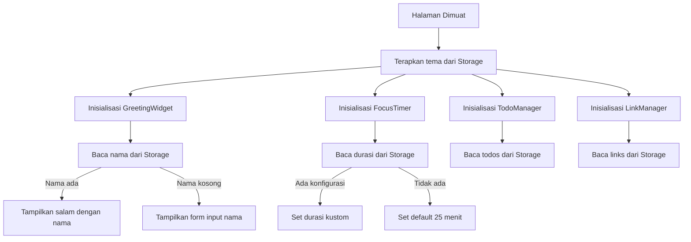
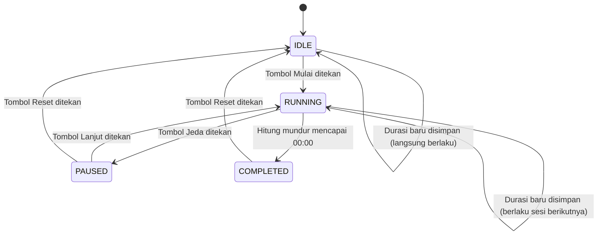

# Dokumen Desain: To-Do Life Dashboard

## Overview

To-Do Life Dashboard adalah aplikasi web berbasis satu halaman (*single-page application*) yang dibangun sepenuhnya dengan HTML, CSS, dan Vanilla JavaScript tanpa framework atau backend server. Aplikasi ini menyatukan empat komponen fungsional — Greeting Widget, Focus Timer (Pomodoro), Todo Manager, dan Link Manager — dalam satu tampilan yang bersih dan responsif.

Seluruh data pengguna (nama, tugas, quick links, preferensi tema, durasi timer) disimpan di Browser Local Storage API di sisi klien. Tidak ada komunikasi jaringan yang dibutuhkan setelah halaman dimuat.

**Tujuan Desain Utama:**
- Satu file HTML, satu file CSS (`css/style.css`), satu file JavaScript (`js/app.js`)
- Modularitas melalui *module pattern* Vanilla JS (IIFE atau ES Modules)
- Pemisahan jelas antara lapisan penyimpanan, logika bisnis, dan UI rendering
- Dukungan Light/Dark mode tanpa *flash of wrong theme*
- Semua interaksi bersifat sinkron kecuali timer interval

---

## Architecture

### Pola Arsitektur

Aplikasi menggunakan pola **MVC ringan tanpa framework** dengan tiga lapisan:

```
┌─────────────────────────────────────────────────────────┐
│                       UI Layer                          │
│  (DOM manipulation, event listeners, rendering)         │
│  GreetingUI | TimerUI | TodoUI | LinkUI | ThemeUI       │
├─────────────────────────────────────────────────────────┤
│                    Logic Layer                          │
│  (validasi, state machine, transformasi data)           │
│  GreetingLogic | TimerLogic | TodoLogic | LinkLogic     │
├─────────────────────────────────────────────────────────┤
│                   Storage Layer                         │
│         StorageService (abstraksi Local Storage)        │
└─────────────────────────────────────────────────────────┘
```

### Diagram Alur Inisialisasi



### State Machine Focus Timer



---

## Components and Interfaces

### StorageService

Lapisan abstraksi tunggal untuk semua operasi Local Storage. Mengisolasi logika penyimpanan agar mudah diganti atau di-mock saat testing.

```javascript
StorageService = {
  get(key: string): any | null,
  set(key: string, value: any): boolean,  // returns false jika gagal
  remove(key: string): void,
  clear(): void
}
```

**Kunci Storage yang digunakan:**

| Kunci | Tipe Data | Deskripsi |
|---|---|---|
| `tld_username` | `string` | Nama pengguna |
| `tld_theme` | `"light" \| "dark"` | Preferensi tema |
| `tld_timer_duration` | `number` | Durasi timer dalam menit (1–120) |
| `tld_todos` | `Todo[]` | Array semua tugas |
| `tld_links` | `QuickLink[]` | Array semua quick links |

### GreetingWidget

Mengelola tampilan waktu, tanggal, dan salam personal.

```javascript
GreetingWidget = {
  init(): void,            // baca storage, mulai interval
  startClock(): void,      // setInterval setiap 1 detik
  updateDisplay(): void,   // perbarui DOM jam, tanggal, salam
  getGreetingText(hour: number, name: string): string,
  formatDate(date: Date): string,  // format Bahasa Indonesia
  promptForName(): void,
  saveName(name: string): boolean,
  changeName(): void
}
```

### FocusTimer

Mengelola state machine hitung mundur Pomodoro.

```javascript
FocusTimer = {
  state: 'IDLE' | 'RUNNING' | 'PAUSED' | 'COMPLETED',
  remainingSeconds: number,
  configuredDuration: number,  // dalam menit
  intervalId: number | null,

  init(): void,
  start(): void,
  pause(): void,
  resume(): void,
  reset(): void,
  tick(): void,           // dipanggil setiap detik oleh interval
  onComplete(): void,     // dipanggil ketika mencapai 00:00
  saveDuration(minutes: number): boolean,
  updateButtonStates(): void,
  formatDisplay(seconds: number): string  // returns "MM:SS"
}
```

### TodoManager

Mengelola CRUD operasi pada daftar tugas.

```javascript
TodoManager = {
  todos: Todo[],

  init(): void,
  addTodo(text: string): boolean,
  toggleTodo(id: string): void,
  editTodo(id: string, newText: string): boolean,
  deleteTodo(id: string): void,
  render(): void,            // re-render seluruh daftar
  persist(): void,           // simpan ke Storage
  validateText(text: string): ValidationResult
}
```

### LinkManager

Mengelola CRUD operasi pada daftar quick links.

```javascript
LinkManager = {
  links: QuickLink[],
  MAX_LINKS: 20,

  init(): void,
  addLink(name: string, url: string): boolean,
  deleteLink(id: string): void,
  render(): void,
  persist(): void,
  validateLink(name: string, url: string): ValidationResult
}
```

### ThemeManager

Mengelola toggle tema dan persistensi.

```javascript
ThemeManager = {
  current: 'light' | 'dark',

  init(): void,   // terapkan tema dari Storage SEBELUM render konten
  toggle(): void,
  apply(theme: 'light' | 'dark'): void,
  persist(theme: 'light' | 'dark'): void
}
```

---

## Data Models

### Todo

```typescript
interface Todo {
  id: string;           // UUID sederhana, contoh: "todo_1729123456789"
  text: string;         // 1–200 karakter
  completed: boolean;
  createdAt: number;    // timestamp Unix ms
}
```

### QuickLink

```typescript
interface QuickLink {
  id: string;           // UUID sederhana, contoh: "link_1729123456789"
  name: string;         // 1–50 karakter
  url: string;          // diawali "http://" atau "https://", maks 2048 karakter
  createdAt: number;    // timestamp Unix ms — digunakan untuk urutan tampil
}
```

### ValidationResult

```typescript
interface ValidationResult {
  valid: boolean;
  errorMessage: string | null;
}
```

### AppState (in-memory, tidak diserialisasi)

```typescript
interface AppState {
  username: string | null;
  theme: 'light' | 'dark';
  timerDuration: number;        // menit
  timerState: 'IDLE' | 'RUNNING' | 'PAUSED' | 'COMPLETED';
  timerRemaining: number;       // detik
}
```

### Struktur File

```
project-root/
├── index.html
├── css/
│   └── style.css          ← satu-satunya file CSS
└── js/
    └── app.js             ← satu-satunya file JavaScript
```

`app.js` diorganisir dengan *module pattern* (IIFE bersarang) atau ES Modules dengan satu entry point:

```javascript
// app.js — urutan inisialisasi
ThemeManager.init();        // harus pertama, cegah flash
GreetingWidget.init();
FocusTimer.init();
TodoManager.init();
LinkManager.init();
```

---

## Correctness Properties

*Properti adalah karakteristik atau perilaku yang harus benar di semua eksekusi sistem yang valid — pada dasarnya, pernyataan formal tentang apa yang harus dilakukan sistem. Properti berfungsi sebagai jembatan antara spesifikasi yang dapat dibaca manusia dan jaminan kebenaran yang dapat diverifikasi secara otomatis.*

### Property 1: Salam berdasarkan jam selalu tepat

*Untuk semua* nilai jam valid (0–23) dan nama pengguna yang valid, fungsi `getGreetingText` harus mengembalikan salam yang sesuai dengan interval waktu yang benar: jam 0–11 menghasilkan "Selamat Pagi", jam 12–14 menghasilkan "Selamat Siang", jam 15–17 menghasilkan "Selamat Sore", dan jam 18–23 menghasilkan "Selamat Malam".

**Validates: Requirements 1.3, 1.4, 1.5, 1.6**

### Property 2: Validasi nama pengguna konsisten

*Untuk semua* string yang diuji, fungsi validasi nama harus menerima tepat string yang terdiri dari 1–50 karakter huruf, spasi, dan tanda hubung, dan menolak semua string lainnya (kosong, hanya spasi, lebih dari 50 karakter, atau mengandung karakter tidak valid).

**Validates: Requirements 2.2, 2.3**

### Property 3: Round-trip penyimpanan nama pengguna

*Untuk semua* nama pengguna yang valid, menyimpan nama ke Storage lalu membacanya kembali harus menghasilkan nilai yang identik dengan yang disimpan.

**Validates: Requirements 2.2, 2.6, 8.2**

### Property 4: Format tampilan timer selalu MM:SS

*Untuk semua* nilai detik dalam rentang 0 hingga 7200 (0–120 menit), fungsi `formatDisplay` harus menghasilkan string dengan format tepat "MM:SS" di mana MM adalah dua digit menit dan SS adalah dua digit detik.

**Validates: Requirements 3.1**

### Property 5: Validasi durasi timer konsisten

*Untuk semua* nilai input, fungsi validasi durasi harus menerima tepat bilangan bulat antara 1 dan 120, dan menolak semua input lainnya (di luar rentang, bukan bilangan bulat, atau kosong).

**Validates: Requirements 4.2, 4.5, 4.6**

### Property 6: Validasi teks tugas konsisten

*Untuk semua* string yang diuji, fungsi validasi tugas harus menerima string tidak kosong dengan panjang 1–200 karakter, dan menolak string kosong atau yang terdiri hanya dari spasi.

**Validates: Requirements 5.2, 5.3, 5.8**

### Property 7: Round-trip penyimpanan daftar tugas

*Untuk semua* array tugas yang valid, menyimpan daftar ke Storage lalu membacanya kembali harus menghasilkan array yang secara struktural identik (id, text, completed, createdAt sama untuk setiap elemen).

**Validates: Requirements 5.10, 8.2**

### Property 8: Validasi Quick Link konsisten

*Untuk semua* pasangan (nama, url) yang diuji, fungsi validasi link harus menerima pasangan dengan nama 1–50 karakter non-spasi-saja dan URL yang diawali "http://" atau "https://" dengan panjang maks 2048 karakter, dan menolak semua kombinasi lainnya.

**Validates: Requirements 6.4, 6.5, 6.6**

### Property 9: Urutan tampil quick links stabil

*Untuk semua* daftar quick links yang valid, memuat ulang dari Storage harus menghasilkan urutan tampil yang identik dengan urutan penambahan dari yang paling lama ke yang paling baru (berdasarkan `createdAt`).

**Validates: Requirements 6.9**

### Property 10: Toggle status tugas bersifat idempoten (round-trip)

*Untuk semua* tugas dengan status apa pun (selesai atau belum selesai), menandai tugas tersebut dua kali berturut-turut harus menghasilkan status yang identik dengan status awal sebelum toggle pertama.

**Validates: Requirements 5.4, 5.5**

### Property 11: Round-trip penyimpanan preferensi tema

*Untuk semua* nilai tema yang valid (`"light"` atau `"dark"`), menyimpan preferensi tema ke Storage lalu membacanya kembali harus menghasilkan nilai yang identik dengan yang disimpan.

**Validates: Requirements 7.4, 8.2**

---

## Error Handling

### Prinsip Umum

- **Gagal senyap pada Storage**: Jika operasi `localStorage.setItem` melempar exception (misalnya kuota penuh), tangkap dengan try-catch, kembalikan `false`, dan lanjutkan tanpa menampilkan error ke pengguna (sesuai req 2.7, 7.6).
- **Gagal dengan notifikasi pada input pengguna**: Semua kegagalan validasi dari aksi pengguna (nama tidak valid, durasi tidak valid, URL tidak valid) harus menampilkan pesan error yang informatif.
- **Fallback ke state default**: Jika data yang dibaca dari Storage tidak valid atau corrupt, gunakan nilai default (req 8.3).

### Tabel Penanganan Error

| Skenario | Perilaku |
|---|---|
| `localStorage.getItem` melempar exception | Tangkap, kembalikan `null`, gunakan default |
| `localStorage.setItem` melempar exception | Tangkap, kembalikan `false`, lanjut sesi |
| JSON.parse gagal pada data tersimpan | Kembalikan `null` / array kosong, gunakan default |
| `new Date()` gagal membaca waktu lokal | Tampilkan pesan "Waktu tidak tersedia" (req 1.7) |
| Nama pengguna tidak valid | Tampilkan pesan validasi, jangan simpan |
| Durasi timer di luar rentang (1–120) | Tampilkan pesan error dengan rentang valid |
| URL tidak diawali http:// atau https:// | Tampilkan pesan "Format URL tidak valid" |
| Jumlah quick link mencapai 20 | Tampilkan pesan batas maksimum tercapai |
| Edit tugas menjadi kosong/spasi | Batalkan, kembalikan teks lama (silent) |

### Validasi Input — Aturan Komprehensif

```
Nama Pengguna:
  - Panjang: 1–50 karakter
  - Karakter: huruf (Unicode), spasi, tanda hubung (-)
  - Regex: /^[a-zA-ZÀ-ÿ\s\-]{1,50}$/

Durasi Timer:
  - Tipe: bilangan bulat
  - Rentang: 1 ≤ nilai ≤ 120
  - Bukan NaN, bukan float

Teks Tugas (tambah/edit):
  - Setelah trim: panjang 1–200 karakter
  - Tidak boleh hanya spasi

Nama Quick Link:
  - Setelah trim: panjang 1–50 karakter
  - Tidak boleh hanya spasi

URL Quick Link:
  - Diawali "http://" atau "https://"
  - Panjang total ≤ 2048 karakter
  - Tidak boleh kosong
```

---

## Testing Strategy

### Pendekatan Pengujian Ganda

Pengujian menggunakan dua pendekatan yang saling melengkapi:

1. **Unit test berbasis contoh**: Memverifikasi kasus spesifik, kondisi tepi, dan perilaku tertentu
2. **Property-based test**: Memverifikasi properti universal yang harus berlaku untuk semua input valid

### Library yang Digunakan

- **Property-Based Testing**: [fast-check](https://fast-check.dev/) — library PBT untuk JavaScript/TypeScript
- **Test Runner**: [Vitest](https://vitest.dev/) atau Jest (keduanya kompatibel dengan fast-check)
- Konfigurasi: minimum **100 iterasi** per property test

### Tag Format untuk Property Test

Setiap property test diberi komentar dengan format:

```javascript
// Feature: todo-life-dashboard, Property {nomor}: {teks properti}
```

### Rencana Test per Modul

#### StorageService

- **Unit test**: get mengembalikan null jika kunci tidak ada; set mengembalikan false saat QuotaExceededError; JSON corrupt dikembalikan sebagai null
- **Property test**: Round-trip (Property 3, 7) — set lalu get menghasilkan nilai identik untuk semua data valid

#### GreetingLogic

- **Unit test**: Setiap interval batas (jam 0, 11, 12, 14, 15, 17, 18, 23) menghasilkan salam yang benar; format tanggal menghasilkan string Bahasa Indonesia
- **Property test**: Salam berdasarkan jam (Property 1); validasi nama (Property 2)

#### FocusTimer (Logic)

- **Unit test**: Transisi state machine (IDLE → RUNNING → PAUSED → RUNNING → COMPLETED → IDLE); durasi default 25 menit saat tidak ada config; durasi baru saat running berlaku sesi berikutnya
- **Property test**: Format MM:SS (Property 4); validasi durasi (Property 5)

#### TodoLogic

- **Unit test**: Tambah tugas muncul di list; toggle selesai mengubah status; hapus menghilangkan item; edit kosong membatalkan perubahan
- **Property test**: Validasi teks (Property 6); round-trip Storage (Property 7)

#### LinkLogic

- **Unit test**: Tambah link tersimpan; hapus dengan konfirmasi; batas 20 link; klik membuka tab baru
- **Property test**: Validasi link (Property 8); urutan stabil (Property 9)

#### ThemeManager

- **Unit test**: Toggle mengubah tema; tema tersimpan di Storage; tema diterapkan sebelum render konten (cek urutan inisialisasi); gagal Storage tidak menampilkan error
- Tidak menggunakan property-based test (toggle on/off tidak memiliki input space yang bervariasi secara bermakna)

### Pengujian Kompatibilitas Browser

Jalankan manual smoke test pada Chrome, Firefox, Edge, dan Safari versi rilis terbaru untuk memverifikasi:
- Semua fitur berfungsi tanpa error console
- Layout responsif pada viewport 320px, 768px, 1440px, 2560px
- Tidak ada *flash of wrong theme* saat memuat ulang

### Pengujian Performa

- Ukur waktu muat dengan DevTools Network (target < 3 detik pada throttling "Fast 3G" atau koneksi 10 Mbps)
- Verifikasi tidak ada *layout shift* saat jam dan timer diperbarui setiap detik (gunakan CLS metric di Lighthouse)
